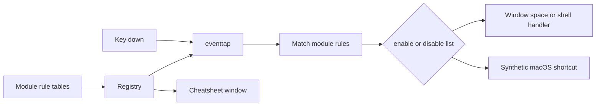

# GNOME-like macOS via Hammerspoon

Rebuild the Hammerspoon config on the current branch (`feat/initial-version`). The previous modules are deleted in the working tree and do not match this task (no GNOME catalog, no original-vs-new cheatsheet columns, app filters are `only`/`except` instead of explicit enable/disable lists). Reuse the proven idea of one `hs.eventtap` that matches a rule, optionally limits it by bundle id, and either runs a handler or posts a synthetic key.

Text caret bindings (task point 6) are a separate module. They use Linux/GTK chords and only run when an editable text field is focused.

## Modifier model

Control takes over the application shortcuts that macOS assigns to Command. Command is then free to act as GNOME Super (it sits in the Super position on a Mac keyboard). Option acts as Alt.

- `Ctrl+C` copies (was `Cmd+C`). `Cmd+C` is no longer Copy.
- `Cmd+Left` tiles left, matching GNOME `Super+Left`.
- Terminals keep real Control chords (`Ctrl+C` interrupt, `Ctrl+Z` suspend, `Ctrl+S` XOFF, `Ctrl+W` delete word) via each binding’s disable list. Terminal copy/paste follows GNOME Terminal: `Ctrl+Shift+C` / `Ctrl+Shift+V`.

Hammerspoon cannot see keys while Secure Input is on (password fields, some terminal states). It also cannot reliably swallow a few shortcuts the system consumes first: `Cmd+Tab`, `Cmd+Space` (Spotlight), `Cmd+Opt+Esc`, Touch ID, and most `XF86*` media keys. Those stay on their macOS behavior.

## Runtime shape



Each rule, in every module, has this shape. Empty `enable` means all applications:

```lua
{
  description = "Copy",
  to = "Ctrl+C",
  from = "Cmd+C",
  mods = { "ctrl" },
  key = "c",
  applications = { enable = {}, disable = { "com.apple.Terminal", "com.googlecode.iterm2" } },
  action = { mods = { "cmd" }, key = "c" }, -- or a function
}
```

Spaces: macOS has no public Spaces API. Switching spaces sends the existing Mission Control shortcuts (`Ctrl+Left` / `Ctrl+Right`, and desktop-number shortcuts when that many spaces exist). Moving a window to another space is best-effort only and often fails on current macOS; the cheatsheet will say so. Vertical workspaces do not exist, so up/down workspace bindings are not implemented.

GNOME entries whose value is `@as []` or `['']` stay unbound. `XF86*` volume, brightness, playback, and keyboard-backlight keys are already handled by macOS and are not duplicated.

The dump lists `Super+Page_Up` for both `switch-to-workspace-left` and `switch-to-workspace-right`. Right will use `Super+Page_Down` (real GNOME default); left keeps `Super+Page_Up`.

## Bindings to implement

Command stands in for GNOME Super, and Option stands in for Alt. Each section is one table: the GNOME chord, the chord Rakuen will register, the original macOS chord, and whether it is possible. The same tables will be copied to [docs/keybindings.md](docs/keybindings.md) so the GitHub repo contains the list.

### Editing (Control performs Command)

Disabled in Terminal, iTerm, WezTerm, kitty, and Alacritty unless the Notes column says otherwise. Minimize stays in the Windows table as GNOME `Super+H`.

| Action | GNOME | Configured as | macOS original | Possible | Notes |
| --- | --- | --- | --- | --- | --- |
| Copy | Ctrl+C | Ctrl+C | Cmd+C | Yes | Disabled in terminals |
| Copy in terminal | Ctrl+Shift+C | Ctrl+Shift+C | Cmd+C | Yes | Terminals only |
| Paste | Ctrl+V | Ctrl+V | Cmd+V | Yes | Disabled in terminals |
| Paste in terminal | Ctrl+Shift+V | Ctrl+Shift+V | Cmd+V | Yes | Terminals only |
| Cut | Ctrl+X | Ctrl+X | Cmd+X | Yes | Disabled in terminals |
| Undo | Ctrl+Z | Ctrl+Z | Cmd+Z | Yes | Disabled in terminals; Ctrl+Z suspends a job |
| Redo | Ctrl+Y, Ctrl+Shift+Z | Ctrl+Y, Ctrl+Shift+Z | Cmd+Shift+Z | Yes | |
| Select all | Ctrl+A | Ctrl+A | Cmd+A | Yes | Disabled in terminals |
| Save | Ctrl+S | Ctrl+S | Cmd+S | Yes | Disabled in terminals; Ctrl+S is XOFF |
| Save as | Ctrl+Shift+S | Ctrl+Shift+S | Cmd+Shift+S | Yes | |
| Find | Ctrl+F | Ctrl+F | Cmd+F | Yes | |
| Find next | Ctrl+G | Ctrl+G | Cmd+G | Yes | |
| New | Ctrl+N | Ctrl+N | Cmd+N | Yes | |
| Open | Ctrl+O | Ctrl+O | Cmd+O | Yes | |
| Close window | Ctrl+W | Ctrl+W | Cmd+W | Yes | Disabled in terminals |
| Quit | Ctrl+Q | Ctrl+Q | Cmd+Q | Yes | Disabled in terminals |
| New tab | Ctrl+T | Ctrl+T | Cmd+T | Yes | |
| Close tab | Ctrl+F4 | Ctrl+F4 | Cmd+W | Yes | |
| Next tab | Ctrl+Tab | Ctrl+Tab | Cmd+Opt+Right | Yes | Disabled in browsers and other apps that already use Ctrl+Tab |
| Previous tab | Ctrl+Shift+Tab | Ctrl+Shift+Tab | Cmd+Opt+Left | Yes | Same restriction as Next tab |
| Bold | Ctrl+B | Ctrl+B | Cmd+B | Yes | |
| Italic | Ctrl+I | Ctrl+I | Cmd+I | Yes | |
| Underline | Ctrl+U | Ctrl+U | Cmd+U | Yes | |
| Settings | Ctrl+, | Ctrl+, | Cmd+, | Yes | |
| Hide app | Ctrl+H | Ctrl+H | Cmd+H | Yes | Disabled in terminals |

### Text navigation (Linux caret keys)

GTK text-field chords, which is what GNOME uses. Readline `Ctrl+A` / `Ctrl+E` / `Ctrl+K` are not used, because `Ctrl+A` is Select All. Bindings run only when the focused accessibility element is an editable text role. Outside a text field they are not consumed, so `Ctrl+Left` / `Ctrl+Right` still switch Spaces and `Ctrl+Up` still opens Mission Control. Synthetic `Cmd+Up` / `Cmd+Down` from `Ctrl+Home` / `Ctrl+End` must not maximize or unmaximize.

Chrome, Electron, and some cross-platform apps do not expose a focused text role, so the binding will not run there. Many Apple keyboards have no Home or End key; if the hardware never sends those events, the Home/End rows cannot fire. Disabled in Terminal, iTerm, WezTerm, kitty, and Alacritty so the shell keeps its own word motion.

| Action | GNOME | Configured as | macOS original | Possible | Notes |
| --- | --- | --- | --- | --- | --- |
| Start of line | Home | Home | Cmd+Left | Yes | Text field only |
| End of line | End | End | Cmd+Right | Yes | Text field only |
| Start of document | Ctrl+Home | Ctrl+Home | Cmd+Up | Yes | Text field only |
| End of document | Ctrl+End | Ctrl+End | Cmd+Down | Yes | Text field only |
| Previous word | Ctrl+Left | Ctrl+Left | Opt+Left | Yes | Text field only |
| Next word | Ctrl+Right | Ctrl+Right | Opt+Right | Yes | Text field only |
| Previous paragraph | Ctrl+Up | Ctrl+Up | Opt+Up | Yes | Text field only |
| Next paragraph | Ctrl+Down | Ctrl+Down | Opt+Down | Yes | Text field only |
| Select to start of line | Shift+Home | Shift+Home | Shift+Cmd+Left | Yes | Text field only |
| Select to end of line | Shift+End | Shift+End | Shift+Cmd+Right | Yes | Text field only |
| Select previous word | Ctrl+Shift+Left | Ctrl+Shift+Left | Shift+Opt+Left | Yes | Text field only |
| Select next word | Ctrl+Shift+Right | Ctrl+Shift+Right | Shift+Opt+Right | Yes | Text field only |
| Select to start of document | Ctrl+Shift+Home | Ctrl+Shift+Home | Shift+Cmd+Up | Yes | Text field only |
| Select to end of document | Ctrl+Shift+End | Ctrl+Shift+End | Shift+Cmd+Down | Yes | Text field only |
| Delete previous word | Ctrl+Backspace | Ctrl+Backspace | Opt+Delete | Yes | Text field only |
| Delete next word | Ctrl+ForwardDelete | Ctrl+ForwardDelete | Opt+ForwardDelete | Yes | Text field only |

### Windows

| Action | GNOME | Configured as | macOS original | Possible | Notes |
| --- | --- | --- | --- | --- | --- |
| Close | Alt+F4 | Opt+F4 | Cmd+W | Yes | Apps that quit on the last window still quit |
| Toggle maximize | Alt+F10 | Opt+F10 | none | Yes | Fills the screen and restores the saved frame. Not a macOS fullscreen Space |
| Maximize | Super+Up | Cmd+Up | none | Yes | Same fill. Ignores synthetic Cmd+Up from Ctrl+Home |
| Unmaximize | Super+Down, Alt+F5 | Cmd+Down, Opt+F5 | none | Yes | Ctrl+Down stays App Expose. Ignores synthetic Cmd+Down from Ctrl+End |
| Tile left | Super+Left | Cmd+Left | none | Yes | Left half; press again to restore. macOS tiling shortcuts may already occupy this chord |
| Tile right | Super+Right | Cmd+Right | none | Yes | Right half; press again to restore |
| Minimize | Super+H | Cmd+H | Cmd+M | Yes | Overrides Hide. Hide moves to Ctrl+H |
| Move to display left | Super+Shift+Left | Cmd+Shift+Left | none | Yes | `window:moveToScreen` |
| Move to display right | Super+Shift+Right | Cmd+Shift+Right | none | Yes | `window:moveToScreen` |
| Move to display up | Super+Shift+Up | Cmd+Shift+Up | none | Yes | No-op when displays are side by side |
| Move to display down | Super+Shift+Down | Cmd+Shift+Down | none | Yes | No-op when displays are side by side |
| Begin move | Alt+F7 | Opt+F7 | none | Yes | Arrow keys move the window; Return ends, Escape cancels |
| Begin resize | Alt+F8 | Opt+F8 | none | Yes | Arrow keys resize from the bottom-right |
| Window action menu | Alt+Space | Opt+Space | none | Partial | Chooser for close, minimize, maximize, tile, and displays. macOS has no window menu. Opt+Space is not Spotlight |
| Toggle fullscreen | unbound | — | Ctrl+Cmd+F | No | Empty in the GNOME dump. Not configured |

### Focus

`Above_Tab` is the grave key.

| Action | GNOME | Configured as | macOS original | Possible | Notes |
| --- | --- | --- | --- | --- | --- |
| Switch applications | Super+Tab, Alt+Tab | Opt+Tab | Cmd+Tab | Partial | Opt+Tab drives the app switcher. Super+Tab is Cmd+Tab, which the system consumes and which stays the native switcher |
| Switch applications backward | Shift+Super+Tab, Shift+Alt+Tab | Opt+Shift+Tab | Cmd+Shift+Tab | Partial | Same restriction as Switch applications |
| Cycle app windows | Super+grave, Alt+grave | Opt+grave, Cmd+grave | Cmd+grave | Yes | |
| Cycle app windows backward | Shift+Super+grave, Shift+Alt+grave | Opt+Shift+grave, Cmd+Shift+grave | Cmd+Shift+grave | Yes | |
| Cycle all windows | Alt+Escape | Opt+Escape | none | Yes | Ordered windows on this Space. Cmd+grave stays per-app |
| Cycle all windows backward | Shift+Alt+Escape | Opt+Shift+Escape | none | Yes | |
| Cycle group | Alt+F6 | Opt+F6 | Cmd+grave | Yes | Same per-app cycle |
| Cycle group backward | Shift+Alt+F6 | Opt+Shift+F6 | Cmd+Shift+grave | Yes | |

### Workspaces

macOS Spaces are a horizontal list and must already exist. The dump lists `Super+Page_Up` for both directions; right uses `Super+Page_Down`.

| Action | GNOME | Configured as | macOS original | Possible | Notes |
| --- | --- | --- | --- | --- | --- |
| Previous space | Super+PageUp, Super+Ctrl+Left | Cmd+PageUp, Cmd+Ctrl+Left | Ctrl+Left | Yes | Sends Ctrl+Left |
| Next space | Super+PageDown, Super+Ctrl+Right | Cmd+PageDown, Cmd+Ctrl+Right | Ctrl+Right | Yes | Sends Ctrl+Right |
| First space | Super+Home | Cmd+Home | none | Partial | Sends Switch to Desktop 1 only when that desktop exists |
| Last space | Super+End | Cmd+End | none | Partial | Sends the shortcut for the last existing desktop |
| Move window to previous space | Super+Shift+PageUp, Super+Shift+Alt+Left, Ctrl+Shift+Alt+Left | Cmd+Shift+PageUp, Cmd+Shift+Opt+Left, Ctrl+Shift+Opt+Left | none | Partial | Best-effort. Hammerspoon often cannot move a window across Spaces |
| Move window to next space | Super+Shift+PageDown, Super+Shift+Alt+Right, Ctrl+Shift+Alt+Right | Cmd+Shift+PageDown, Cmd+Shift+Opt+Right, Ctrl+Shift+Opt+Right | none | Partial | Same restriction |
| Move window to first space | Super+Shift+Home | Cmd+Shift+Home | none | Partial | Same restriction |
| Move window to last space | Super+Shift+End | Cmd+Shift+End | none | Partial | Same restriction |
| Move window up or down a workspace | Ctrl+Shift+Alt+Up, Ctrl+Shift+Alt+Down | — | none | No | Spaces are not a vertical grid |
| Switch workspace up or down | unbound in the dump | — | none | No | No vertical Spaces |

### Shell

| Action | GNOME | Configured as | macOS original | Possible | Notes |
| --- | --- | --- | --- | --- | --- |
| Run dialog | Alt+F2 | Opt+F2 | Cmd+Space | Yes | Opens Spotlight. Cmd+Space stays Spotlight |
| Application grid | Super+A | Cmd+A | Launchpad (F4) | Yes | Select All is Ctrl+A |
| Screenshot UI | Print | F13, and native Cmd+Shift+5 | Cmd+Shift+5 | Yes | Mac keyboards have no Print key. F13 is the stand-in |
| Screenshot area | Shift+Print | Shift+F13 | Cmd+Shift+4 | Yes | |
| Screenshot window | Alt+Print | Opt+F13 | Cmd+Shift+4 then Space | Yes | `screencapture -l`. Needs Screen Recording permission |
| Screen recording UI | Ctrl+Shift+Alt+R | Ctrl+Shift+Opt+R | Cmd+Shift+5 | Yes | Opens the screenshot panel. The recording tab is not separately addressable |
| Overview up | Super+Alt+Up | Cmd+Opt+Up | Ctrl+Left | Partial | No overview. Switches to the previous Space |
| Overview down | Super+Alt+Down | Cmd+Opt+Down | Ctrl+Right | Partial | Switches to the next Space |
| Quick settings | Super+S | Cmd+S | none | Partial | Opens System Settings. Control Center cannot be toggled |
| Message tray | Super+V, Super+M | Cmd+V, Cmd+M | none | Partial | Clicks the Notification Center status item. That target moves across macOS versions. Paste is Ctrl+V |
| Help | Super+F1 | Cmd+F1 | Cmd+Shift+/ | Partial | Sends the front app Help shortcut |

### Session and accessibility

| Action | GNOME | Configured as | macOS original | Possible | Notes |
| --- | --- | --- | --- | --- | --- |
| Lock | Super+L | Cmd+L | Cmd+Ctrl+Q | Yes | `hs.caffeinate.lockScreen`. Browsers keep location-bar focus on Ctrl+L, enabled for browsers only |
| Log out | Ctrl+Alt+Delete | Ctrl+Opt+ForwardDelete | Cmd+Shift+Q | Yes | Confirms, then tells loginwindow to log out |
| Zoom toggle | Alt+Super+8 | Opt+Cmd+8 | Opt+Cmd+8 | Yes | Native shortcut, listed in the cheatsheet |
| Zoom in | Alt+Super+= | Opt+Cmd+= | Opt+Cmd+= | Yes | Native shortcut |
| Zoom out | Alt+Super+- | Opt+Cmd+- | Opt+Cmd+- | Yes | Native shortcut |
| Screen reader | Alt+Super+S | Opt+Cmd+S | Cmd+F5 | Partial | Toggles VoiceOver. VoiceOver must already be installed |

## Cheatsheet contents

The window lists only rules the binder registers, grouped by module. Each row shows the new chord, the original macOS chord (or “none”), and the description. Partial bindings include a one-line limit in the description (for example, “best-effort; Spaces cannot always accept a moved window”).

## Install and check

After implementation, run `bin/install.sh` against a local checkout, confirm `~/.hammerspoon` is populated, reload Hammerspoon, and verify: `Ctrl+C` copies in TextEdit, `Ctrl+C` still interrupts in Terminal, `Cmd+Left` tiles, `Opt+F4` closes, `Ctrl+Left` moves by word in TextEdit and still switches Spaces when no text field is focused, `Ctrl+Alt+/` opens the cheatsheet with all three columns.

## TODOs

1. Add Hammerspoon init and show message (Rakuen Is Ready)
2. Add eventtap binder; It should simply log the keystrokes to the Hammerspoon console, while allowing them to proceed as usual without disrupting their normal function. It must not interfere with the system; it should only log the keys pressed and let the event continue as normal.
3. And per-binding enable/disable application lists files without link them to the keybinding.
4. Link the per-binding list one by one to be able to test them individually
5. Implement editing, text navigation, windows, focus, workspaces, shell, session, and accessibility modules from the binding list
6. Add a scrollable cheatsheet window with new binding, original binding, and description
7. Add bin/install.sh (Homebrew Hammerspoon + config copy, works from clone or curl) and README usage
8. Add docs/keybindings.md with the same sectioned markdown tables as this plan
9. Add clipboard history management (list, copy from a list entry)